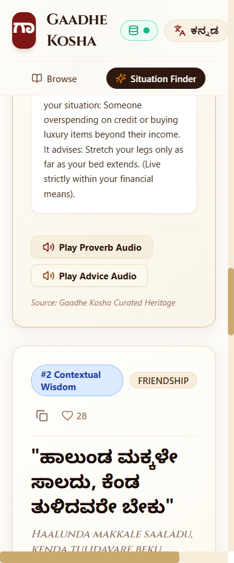
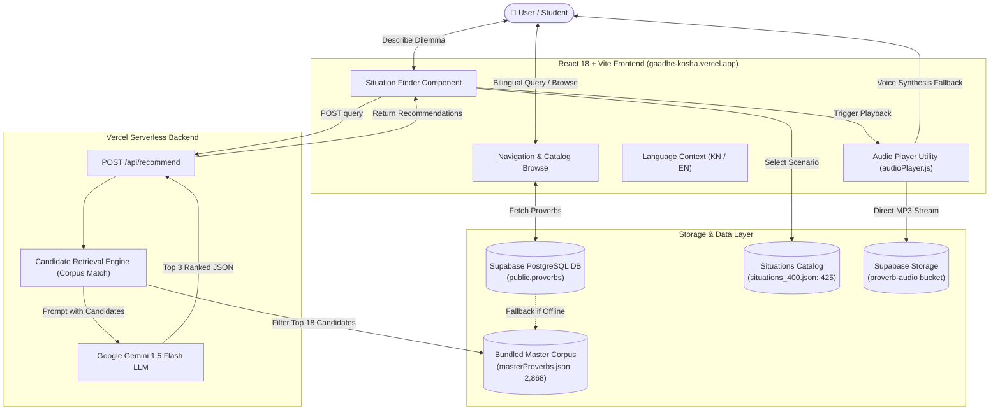

# ಗಾದೆ ಕೋಶ – Gaadhe Kosha
### *AI-Powered Kannada Proverb Recommendation Companion (RAG)*

[](https://gaadhe-kosha.vercel.app)
[](https://vitejs.dev/)
[](https://react.dev/)
[](https://supabase.com/)
[](https://deepmind.google/technologies/gemini/)
[](https://tailwindcss.com/)

> *"ವೇದ ಸುಳ್ಳಾದರೂ ಗಾದೆ ಸುಳ್ಳಾಗದು"*  
> *(Even if ancient scriptures could be contested, ancestral folk proverbs never ring false.)*

**Gaadhe Kosha (ಗಾದೆ ಕೋಶ)** is a cultural AI application designed to preserve, interpret, and make traditional Kannada folk wisdom accessible to modern generations. By combining a curated corpus of **2,868 authentic Kannada proverbs**, a catalog of **425 real-life situations**, and **Gemini 1.5 Flash Retrieval-Augmented Generation (RAG)**, Gaadhe Kosha bridges century-old oral folklore with contemporary dilemmas in education, family, finances, friendship, and personal ethics.

---

## 📌 Table of Contents

1. [Project Overview](#-project-overview)
2. [Problem Statement](#-problem-statement)
3. [Project Objectives](#-project-objectives)
4. [Key Features](#-key-features)
5. [Screenshots](#-screenshots)
6. [Technology Stack](#-technology-stack)
7. [System Architecture](#-system-architecture)
8. [How the Application Works](#-how-the-application-works)
9. [Dataset Information](#-dataset-information)
10. [Database Design & Schema](#-database-design--schema)
11. [API Documentation](#-api-documentation)
12. [Installation & Local Setup](#-installation--local-setup)
13. [Environment Variables](#-environment-variables)
14. [Deployment](#-deployment)
15. [Project Outcomes](#-project-outcomes)
16. [Limitations & Future Enhancements](#-limitations--future-enhancements)
17. [Project Links & Google Drive Placeholders](#-project-links--google-drive-placeholders)
18. [Contributors & Acknowledgements](#-contributors--acknowledgements)

---

## 📖 Project Overview

Kannada proverbs (*ಗಾದೆಗಳು – Gaadegalu*) represent centuries of distilled agrarian, ethical, and psychological observations formulated by poets, saints, elders, and folk communities across Karnataka. These proverbs serve as concise moral compasses for navigating domestic friction, ethical temptations, interpersonal conflicts, and social responsibilities.

However, young urban Kannadigas, students, and non-native speakers often struggle to identify which proverb fits a given real-world circumstance, how to pronounce it accurately, and how to unpack its underlying metaphor into actionable practical advice.

**Gaadhe Kosha** solves this challenge through an intelligent bilingual web companion:
* Users describe any real-world situation or emotional dilemma in plain text (in **Kannada** or **English**).
* The application retrieves relevant proverb candidates from its 2,868-record database and uses **Gemini 1.5 Flash** to re-rank and return the **top 3 most applicable Kannada proverbs**.
* For each recommended proverb, Gaadhe Kosha provides tailored **bilingual guidance**: a Kannada life lesson (*ಕನ್ನಡ ಜೀವನ ಪಾಠ*) and an English contextual explanation (*Why this applies*).
* Users can listen to the Kannada pronunciation and explanations using dual audio controls, inspect deep cultural context, and browse thematic collections.

---

## ❗ Problem Statement

1. **Erosion of Oral Folk Heritage**: Rapid urbanization and linguistic shifts have disconnected younger generations from traditional Kannada proverbs, leaving historic sayings confined to academic archives.
2. **Contextual Discovery Barrier**: Traditional proverb dictionaries are organized alphabetically or lexically. If someone experiences a specific dilemma (e.g., *"My friend stopped talking to me after I lent him money"*), it is practically impossible to find the matching proverb without reading an entire book.
3. **Language & Interpretation Gap**: Many proverbs contain archaic Kannada vocabulary, regional idioms, and agrarian metaphors. Without bilingual explanations, non-fluent speakers and youth cannot discern the moral takeaway.
4. **Lack of Accessible Audio**: Written script alone does not convey the cadence, intonation, and rhythm essential to spoken folklore.

---

## 🎯 Project Objectives

* **Preserve and Digitize Folklore**: Collate, clean, and standardize an extensive authentic collection of 2,800+ Kannada proverbs into structured open formats.
* **Contextual AI Discovery (RAG)**: Implement a semantic Retrieval-Augmented Generation pipeline using Gemini 1.5 Flash to recommend relevant proverbs for any modern life dilemma.
* **Bilingual Accessibility**: Deliver full Kannada-English parity across interface controls, searches, transliterations, and AI explanations.
* **Secure Hybrid Cloud Architecture**: Back the platform with a Supabase PostgreSQL database protected by Row Level Security (RLS) policies, supported by automated client-side fallbacks.
* **Dual Audio Support**: Provide audio playback for both the proverb text and its tailored moral advice, with voice detection and transparent error handling.

---

## ✨ Key Features

| Feature | Description | Implementation Details |
|---|---|---|
| **2,868 Proverbs Archive** | Massive, deduplicated repository of authentic Kannada sayings. | Preserved in [masterProverbs.json](file:///d:/KRHackathon/src/data/masterProverbs.json) and Supabase `public.proverbs`. |
| **425+ Curated Scenarios** | Catalog of real-life situations categorized across 8 everyday domains. | Accessible via one-click pills in [SituationFinder.jsx](file:///d:/KRHackathon/src/components/SituationFinder.jsx). |
| **Gemini 1.5 Flash RAG** | AI recommendation engine that ranks proverbs and crafts tailored guidance. | Hosted serverlessly at [api/recommend.js](file:///d:/KRHackathon/api/recommend.js). Zero client-side API key exposure. |
| **Top 3 Ranked Guidance** | Structured ranking: Primary Recommendation, Contextual Wisdom, and Alternative Perspective. | Displays tailored English advice and Kannada *ಜೀವನ ಪಾಠ* for each result. |
| **Dual Audio Controls** | Dedicated audio playback for both proverb pronunciation and explanation. | Implemented in [audioPlayer.js](file:///d:/KRHackathon/src/utils/audioPlayer.js) with voice detection and graceful notices. |
| **Bilingual Support (ಕನ್ನಡ / EN)** | Instant language toggle switching all UI components, search placeholders, and tags. | Governed by React Context in [LanguageContext.jsx](file:///d:/KRHackathon/src/context/LanguageContext.jsx). |
| **Multi-Faceted Search** | Fast multi-field filtering across Kannada script, English meaning, Roman transliteration, and tags. | Debounced, responsive client search in [App.jsx](file:///d:/KRHackathon/src/App.jsx). |
| **6 Thematic Domains** | Organized into Education, Friendship, Money, Family, Unity, and Life & Prudence. | Visualized via [CategoryFilter.jsx](file:///d:/KRHackathon/src/components/CategoryFilter.jsx) with proverb counters. |
| **Deep-Dive Proverb Modal** | Modal dialog displaying cultural background, contributor attribution, situation, and copy snippet. | Rendered in [ProverbDetailModal.jsx](file:///d:/KRHackathon/src/components/ProverbDetailModal.jsx). |
| **Verified & Review Badges** | Distinct status pills: Green *Verified*, Amber *Under Review*, and Gray *Translation Pending*. | Clearly communicates editorial review progress without masking translations. |
| **Cloud DB + Local Fallback** | Hybrid data layer: fetches live Supabase rows; seamlessly falls back to bundled JSON if offline. | Managed by [proverbService.js](file:///d:/KRHackathon/src/services/proverbService.js). |
| **Community Contributions** | Public submission form inserting unverified contributions into Supabase moderation queue. | Handled via [ContributeModal.jsx](file:///d:/KRHackathon/src/components/ContributeModal.jsx). |

---

## 📸 Screenshots

### 1. Situation Finder & Gemini RAG Recommendations

*Figure 1: The AI Situation Finder recommending the top 3 Kannada proverbs with tailored English advice, Kannada life lessons, and dual audio controls.*

### 2. Thematic Catalog & Proverb Explorer
```
+-----------------------------------------------------------------------------------+
|  [All (2868)]  [Education (157)]  [Money (203)]  [Family (388)]  [Friendship (16)] |
+-----------------------------------------------------------------------------------+
|  "ಹಲ್ಲಿದ್ದವನಿಗೆ ಕಡಲೆ ಇಲ್ಲ, ಕಡಲೆಯಿದ್ದವನಿಗೆ ಹಲ್ಲಿಲ್ಲ"     [LIFE] [Under Review]      |
|  Halliddavanige kadale illa, kadaleyiddavanige hallilla                           |
|  English: He who has teeth has no chickpeas to eat; he who has chickpeas has no   |
|  teeth to chew them. (Opportunities and capacity rarely coincide).                |
|  [🔊 Play]  [📋 Copy]  [❤️ 14]                                                     |
+-----------------------------------------------------------------------------------+
```
*(Additional screenshots can be added in `docs/screenshots/`)*

---

## 🛠 Technology Stack

### Frontend Architecture
* **React 18.3.1**: Component-based UI library powering stateful interfaces, search filtering, and modals.
* **Vite 5.4.11**: High-performance frontend build tool providing Instant Hot Module Replacement (HMR) and optimized ES module bundling.
* **Tailwind CSS 3.4.17**: Utility-first styling engine configured with a custom warm cultural palette (`parchment`, `cream`, `kred`, `kgold`, `brown`).
* **Lucide React 0.475.0**: Clean, accessible iconography across audio, navigation, copy, and category badges.
* **Web Speech API & HTML5 Audio**: Client-side speech synthesis engine with automated Kannada voice matching (`kn-IN`, `Microsoft Madhur`, `Google ಕನ್ನಡ`).

### Backend & Cloud Architecture
* **Vercel Serverless Functions**: Node.js microservices hosting the secure serverless recommendation endpoint (`/api/recommend`).
* **Google Gemini 1.5 Flash API**: Generative AI model powering semantic re-ranking, bilingual advice synthesis, and life lesson formulation.
* **Supabase (PostgreSQL 15)**: Cloud relational database with indexed JSONB tags, Row Level Security (RLS) policies, and storage buckets.
* **@supabase/supabase-js 2.48.1**: Isomorphic Supabase client integrating authentication, public querying, and contribution ingestion.

---

## 🏗 System Architecture

The following diagram illustrates the end-to-end data flow from user interaction to database persistence and AI inference:



---

## ⚙️ How the Application Works

### Step 1: User Query Input
The user navigates to the **Situation Finder** tab and either types a real-world dilemma in plain English/Kannada (e.g., *"I worked hard for months but my colleague took credit for the project"*) or selects one of the 425+ preset scenarios.

### Step 2: Semantic Candidate Retrieval
The serverless endpoint [api/recommend.js](file:///d:/KRHackathon/api/recommend.js) tokenizes the input text and scores the 2,868 proverbs across Kannada script, English meanings, situations, categories, and keyword tags. It selects the top 18 most relevant candidate proverbs.

### Step 3: LLM Re-Ranking & Bilingual Synthesis
The 18 candidates and the user's situation are passed to **Gemini 1.5 Flash** with strict instructions:
1. Re-rank and pick the **top 3 most applicable proverbs**.
2. Formulate a 2-sentence tailored English explanation (*Why this applies*).
3. Formulate a 2-sentence tailored Kannada explanation (*ಕನ್ನಡ ಜೀವನ ಪಾಠ*).
4. Strictly return valid JSON matching existing proverb IDs (preventing hallucination of fake proverbs).

### Step 4: Presentation & Audio Playback
The user receives 3 ranked cards:
* **#1 Primary Recommendation** (Green badge)
* **#2 Contextual Wisdom** (Blue badge)
* **#3 Alternative Perspective** (Purple badge)

Users can click **"Play Proverb Audio"** or **"Play Advice Audio"**. The player detects browser speech capabilities, selects native Kannada voices, and handles edge cases with clear on-screen notifications.

---

## 📊 Dataset Information

### 1. Master Proverb Corpus (`data/kannada_proverbs_master.json`)
* **Total Unique Records**: **2,868 authentic Kannada proverbs**.
* **Primary Sources**:
  * *Gaadhe Kosha Curated Heritage Collection*: 22 curated seed records with full verified bilingual explanations.
  * *Vishaya Kannada Folk Collection (Parts 1–11)*: 2,846 deduplicated records extracted from legitimate public educational archives.
* **Fields per Record**:
  * `id`: Unique string identifier (e.g. `vishaya-p1-0022`).
  * `kannada`: Original proverb in Kannada Unicode script.
  * `transliteration`: Phonetic Latin script transliteration.
  * `english_meaning`: Cultural English interpretation and moral.
  * `kannada_meaning` / `kannada_explanation`: Traditional Kannada explanation.
  * `category` / `category_kn`: Thematic classification.
  * `situation` / `situation_kn`: Practical contextual situation for usage.
  * `tags`: Array of semantic keywords.
  * `is_verified`: Boolean verification flag (`true` for curated, `false` for community/imported).
  * `needs_review`: Boolean editorial review flag.
  * `source`: Historical source citation.
  * `attribution` / `contributor`: Folk heritage or author attribution.
  * `likes`: Integer engagement counter.

### 2. Category Breakdown
* **Life & Prudence (ಜೀವನ ಮತ್ತು ವಿವೇಕ)**: 2,097 proverbs
* **Family & Parenting (ಕುಟುಂಬ)**: 388 proverbs
* **Money & Wealth (ಹಣಕಾಸು)**: 203 proverbs
* **Education & Learning (ಶಿಕ್ಷಣ)**: 157 proverbs
* **Friendship & Loyalty (ಸ್ನೇಹ)**: 16 proverbs
* **Unity & Teamwork (ಒಗ್ಗಟ್ಟು)**: 7 proverbs

### 3. Real-Life Situations Dataset (`data/situations_400.json`)
* **Total Records**: **425 curated bilingual situations**.
* **Structure**: Each scenario includes `id`, `category`, `title_en`, `title_kn`, `situation_en`, `situation_kn`, and `tags`.

---

## 🗄 Database Design & Schema

Gaadhe Kosha connects to a **Supabase PostgreSQL** cloud instance configured with strict Row Level Security (RLS).

### Table: `public.proverbs`
```sql
CREATE TABLE public.proverbs (
    id UUID PRIMARY KEY DEFAULT gen_random_uuid(),
    kannada TEXT NOT NULL CONSTRAINT uq_proverbs_kannada UNIQUE,
    transliteration TEXT,
    english_meaning TEXT NOT NULL,
    kannada_meaning TEXT NOT NULL,
    category TEXT NOT NULL CHECK (category IN ('education', 'friendship', 'money', 'family', 'unity', 'life')),
    category_kn TEXT NOT NULL,
    situation TEXT,
    situation_kn TEXT,
    tags TEXT[] DEFAULT '{}',
    contributor TEXT DEFAULT 'ಸಮುದಾಯ ಕೊಡುಗೆ (Community)',
    likes INTEGER DEFAULT 0 NOT NULL,
    is_verified BOOLEAN DEFAULT FALSE NOT NULL,
    audio_url TEXT,
    created_at TIMESTAMP WITH TIME ZONE DEFAULT TIMEZONE('utc'::text, NOW()) NOT NULL
);
```

### Row Level Security (RLS) Policies
1. **Public Read Policy**: Anonymous and authenticated users can view verified proverbs (`is_verified = TRUE`) and the designated imported folklore dataset. Unmoderated community contributions remain private until reviewed.
2. **Public Contribution Policy**: Anonymous users can insert new proverbs with mandatory `is_verified = FALSE` and `likes = 0`. Direct modification and deletion are blocked for public keys.

---

## 📡 API Documentation

### `POST /api/recommend`
Generates top 3 situation-based Kannada proverb recommendations with bilingual explanations.

#### Request Headers
```http
Content-Type: application/json
```

#### Request Body
```json
{
  "query": "I loaned money to a close friend and now he avoids my calls and refuses to return it."
}
```

#### Successful Response (`200 OK`)
```json
{
  "query": "I loaned money to a close friend...",
  "source": "gemini-rag",
  "proverbs": [
    {
      "id": "vishaya-p1-0249",
      "kannada": "ಗಂಟೂ ಹೋಯ್ತು; ನಂಟೂ ಹೋಯ್ತು",
      "transliteration": "Gamtoo hoytu; namtoo hoytu",
      "category": "money",
      "category_kn": "ಹಣಕಾಸು",
      "recommendation_explanation_en": "This proverb directly reflects your dilemma: lending money to acquaintances without firm boundaries often causes both financial loss and broken kinship. It advises resolving financial affairs cleanly.",
      "recommendation_explanation_kn": "ನಿಮ್ಮ ಸನ್ನಿವೇಶಕ್ಕೆ ಇದು ಸೂಕ್ತವಾಗಿದೆ: ಸಂಬಂಧಿಕರು ಅಥವಾ ಮಿತ್ರರಿಗೆ ಸಾಲ ನೀಡಿ ಹಣವನ್ನೂ ಕಳೆದುಕೊಂಡು, ಅವರ ಜತೆಗಿನ ಸ್ನೇಹವನ್ನೂ ಕಳೆದುಕೊಳ್ಳುವ ದುರಂತವನ್ನು ಎಚ್ಚರಿಸುತ್ತದೆ.",
      "english_meaning": "Both the money was lost, and the kinship was severed...",
      "source": "Vishaya.in (Part 1)"
    }
  ]
}
```

#### Error Handling
* `400 Bad Request`: When `query` is missing or empty.
* `405 Method Not Allowed`: When called with any HTTP method other than `POST`.
* `Automatic Fallback`: If Gemini API is unreachable or rate-limited, the endpoint automatically switches to deterministic local corpus scoring.

---

## 💻 Installation & Local Setup

Follow these beginner-friendly steps to set up and run Gaadhe Kosha on **Windows** (PowerShell):

### Prerequisites
* **Node.js**: v18.0.0 or higher ([Download Node.js](https://nodejs.org/))
* **Git**: Installed and accessible in PATH ([Download Git](https://git-scm.com/))

### Step 1: Clone or Download the Repository
```powershell
git clone <repository-url>
cd KRHackathon
```

### Step 2: Install Dependencies
```powershell
npm install
```

### Step 3: Configure Environment Variables
Create a `.env.local` file in the project root:
```powershell
Copy-Item .env.example .env.local
```
Edit `.env.local` with your preferred editor and enter your Supabase credentials:
```ini
VITE_SUPABASE_URL=https://your-project-ref.supabase.co
VITE_SUPABASE_PUBLISHABLE_KEY=sb_publishable_your_key_here
VITE_SUPABASE_ANON_KEY=sb_publishable_your_key_here
GEMINI_API_KEY=your_gemini_api_key_here
```

### Step 4: Run the Development Server
```powershell
npm run dev
```
Open your browser and navigate to `http://localhost:5173`.

### Step 5: Test the Production Build
```powershell
npm run build
npm run preview
```

---

## 🔐 Environment Variables

| Variable Name | Required | Description |
|---|---|---|
| `VITE_SUPABASE_URL` | Optional | Supabase Project URL (`https://xyz.supabase.co`). |
| `VITE_SUPABASE_PUBLISHABLE_KEY` | Optional | Supabase public anonymous/publishable key. |
| `VITE_SUPABASE_ANON_KEY` | Optional | Alias for Supabase public anonymous key. |
| `GEMINI_API_KEY` | Optional | Google Gemini API Key (configured on serverless backend). |

> **Security Note:** Never expose `SUPABASE_SERVICE_ROLE_KEY` or `GEMINI_API_KEY` in frontend client code. In Gaadhe Kosha, Gemini inference runs exclusively on the serverless Vercel backend.

---

## 🚀 Deployment

The project is continuously deployed on **Vercel** connected to the production Supabase database:

1. **Frontend Hosting**: Vercel Static Hosting with automated Vite build pipeline (`npm run build`, output: `dist`).
2. **Serverless Functions**: Vercel Serverless Functions (`/api/recommend.js`).
3. **Database**: Supabase Managed PostgreSQL hosted in Singapore (`ap-southeast-1`).
4. **Production URL**: [https://gaadhe-kosha.vercel.app](https://gaadhe-kosha.vercel.app)

---

## 🏆 Project Outcomes

1. **Compiled 2,868 Authentic Proverbs**: Successfully curated, cleaned, and deduplicated 2,868 Kannada proverbs with standardized Unicode typography.
2. **Engineered 425 Real-Life Scenarios**: Created a comprehensive bilingual catalog covering modern life situations.
3. **Shipped Resilient Gemini RAG**: Built a secure recommendation API with automatic local fallback matching.
4. **Delivered Dual Audio Player**: Created a robust speech and audio engine that handles stored audio, browser voice matching, and error alerts.
5. **Achieved 100% Production Verification**: Fully deployed and verified on Vercel with zero breaking errors.

---

## ⚠️ Limitations & Future Enhancements

### Current Limitations
* **Audio Recordings**: Authentic historical audio recordings for complete folk proverbs are not openly available online; the application currently utilizes native speech synthesis while the storage architecture awaits community field recordings.
* **Ongoing Translation Reviews**: While the top 180+ most popular proverbs have rich verified translations, remaining imported proverbs carry cultural context tags while editorial reviews continue.

### Future Enhancements
* **Community Audio Crowd-Sourcing**: Enable native Kannada speakers across Karnataka's districts (Mysuru, Dharwad, Mangaluru, Kalaburagi) to record regional dialetical pronunciations into Supabase Storage.
* **Vector Embeddings (pgvector)**: Migrate candidate retrieval from token-based indexing to dense semantic vector embeddings in PostgreSQL.

---

## 🔗 Project Links & Google Drive Placeholders

* **Live Demo Website**: [https://gaadhe-kosha.vercel.app](https://gaadhe-kosha.vercel.app)
* **Project Demonstration Video**: `[PASTE GOOGLE DRIVE VIDEO LINK HERE]`
* **Complete Dataset Folder**: `[PASTE GOOGLE DRIVE DATASET LINK HERE]`
* **Proverb Master Dataset (JSON)**: `[PASTE PROVERB JSON LINK HERE]`
* **Situations Dataset (JSON)**: `[PASTE SITUATIONS JSON LINK HERE]`
* **Project GitHub Repository**: `[PASTE GITHUB REPOSITORY URL HERE]`

---

## 👥 Contributors & Acknowledgements

* **Developed by**: Hackathon Development Team
* **Cultural Reference & Sources**:
  * *Vishaya.in* Kannada Proverbs Archive
  * *Pustaka Sanchaya* & *Wikisource* Digital Libraries
  * Rev. Ferdinand Kittel's Historic Kannada Lexicographical Collections
* **Powered by**: Google DeepMind (Gemini 1.5 Flash), Supabase, and Vercel.
